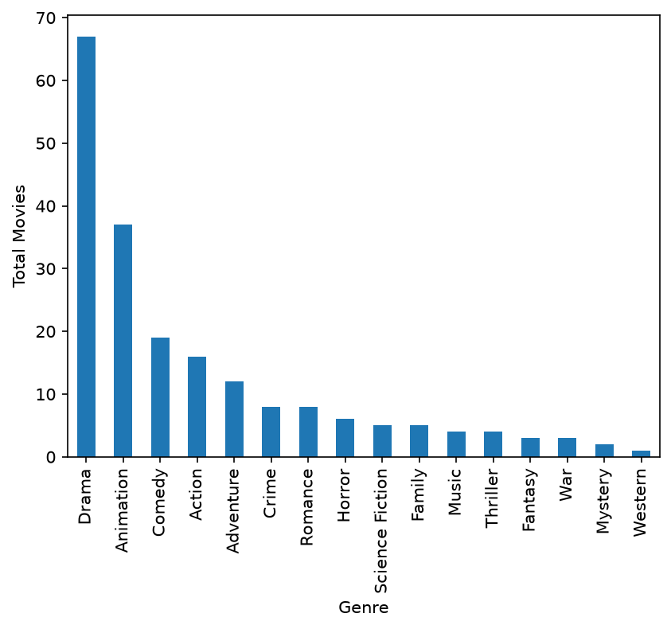
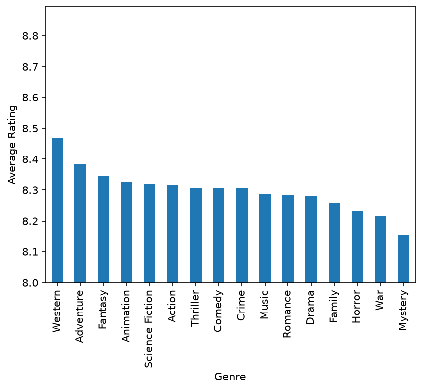

## Introduction
Ever since I was a child, watching movies has been an integral part of activities I would do. One of my family’s favorite pastimes is going to the theater and catching the latest action movie. As I’ve grown older, watching movies has remained a passion of mine. It’s a relaxing outlet to look forward to from the regular beats of school or work. It’s also a common interest between my wife and I. Watching movies often sparks lively discussion or debate between us regarding whether or not we liked the movie, what aspects we enjoyed, and what we would change about it. My wife and I are actively searching for new movies to watch with our dinners, thus inspiring this project. I scraped data from The Movies Database website to find 200 of the highest rated movies according to its users. By doing this, I hope to add some good entries to the watchlist of movies my wife and I haven’t seen before.


## Ethics
According to The Movies Database terms of use, use of their API services requires proper attribution by displaying their logo and placing the following notice on the project: "This [website, program, service, application, product] uses TMDB and the TMDB APIs but is not endorsed, certified, or otherwise approved by TMDB." I have followed these specified terms while working on this project.

## Steps of Retrieving Data Using an API

To get started on using an API, it’s important to first read their terms of service to ensure we follow proper ethics. After we understand the limitations, we can get started in Python. For this project and most likely other projects involving API, we will be using the requests, os, and dotenv libraries. The API key should be stored in a separate .env file so it would not be made public. The os and dotenv libraries allow us to pull the API key into our main scraper while keeping it hidden like so:

```{python}
# load_dotenv()
# api = os.environ.get("api_key")
```

Note: The code is commented out to simply demonstrate syntax.

The get() function under the requests library retrieves data from a website that we can further manipulate in Python. It can receive two parameters: the URL and parameters to be appended to the URL. The URL parameter to enter is typically adding “api” before the URL of the website you want to scrape. For this project, the URL I entered is “https://api.themoviedb.org/3/movie/top_rated". The second parameter, “params,” is a dictionary with values that is appended to the URL in the first parameter so the get() function can retrieve that specific page. For further details regarding the code, please visit the GitHub repository to my project linked at the bottom of this blog. To transform the object created from the get() function into a DataFrame, we can first use the json() function to translate the object into a JSON object. The new JSON object looks very similar to a dictionary, so we typically can find the variables and their corresponding values in the “value” component. For this project, the variables and their values were under the “results” key.

```{json}
{'page': 13,
 'results': [{'adult': False,
   'backdrop_path': '/y2FNZLHynsevBnVTocGW6c3pQpr.jpg',
   'genre_ids': [18],
   'id': 422,
   'title': '8½',
   'original_language': 'it',
   'original_title': '8½',
   'overview': 'Guido Anselmi, a film director, finds himself creatively barren at the peak of his career. Urged by his doctors to rest, Anselmi heads for a luxurious resort, but a sorry group gathers—his producer, staff, actors, wife, mistress, and relatives—each one begging him to get on with the show. In retreat from their dependency, he fantasizes about past women and dreams of his childhood.',
   'popularity': 6.4544,
   'poster_path': '/23VIf7zNxAgaXwIlvzd3IvOd9sY.jpg',
   'release_date': '1963-02-14',
   'softcore': False,
   'video': False,
   'vote_average': 8.069,
   'vote_count': 2623}
```

Note: The example shown above is only a portion of the JSON output.

We can append these values into a list, then use the pandas function pd.DataFrame() to finally transform the list into a DataFrame. Afterwards, feel free to use the plethora of pandas functions to analyze and manipulate the data.


## EDA Highlights

The cleaned dataset includes 200 observations and five variables. I chose to include the movie title, year released, synopsis, genre, and user rating. Here are some interesting findings after exploring the dataset:

1. Three of the top five highest rated movies are animated.

2. Among the 200 movies, drama and animated films dominate over half   the list with 67 drama films and 37 animated films.



3. Among the 200 movies, more films came from the year 2026 than any other year (21). The results may speak to recency bias or lack of user ratings that inflate its score.

4. Among the 200 movies, western, adventure, and fantasy films have the highest mean ratings. However, there is only one western film in the dataset, so that point is very skewed.



## Links

Click [here](https://www.themoviedb.org/) to visit The Movies Database, click [here](https://www.geeksforgeeks.org/python/python-api-tutorial-getting-started-with-apis/) to learn more about APIs, click [here](https://www.w3schools.com/python/pandas/) to learn more about pandas basics, and click [here](https://github.com/richhuang000/data_acquisition) to view the repository containing the code I used for my project
